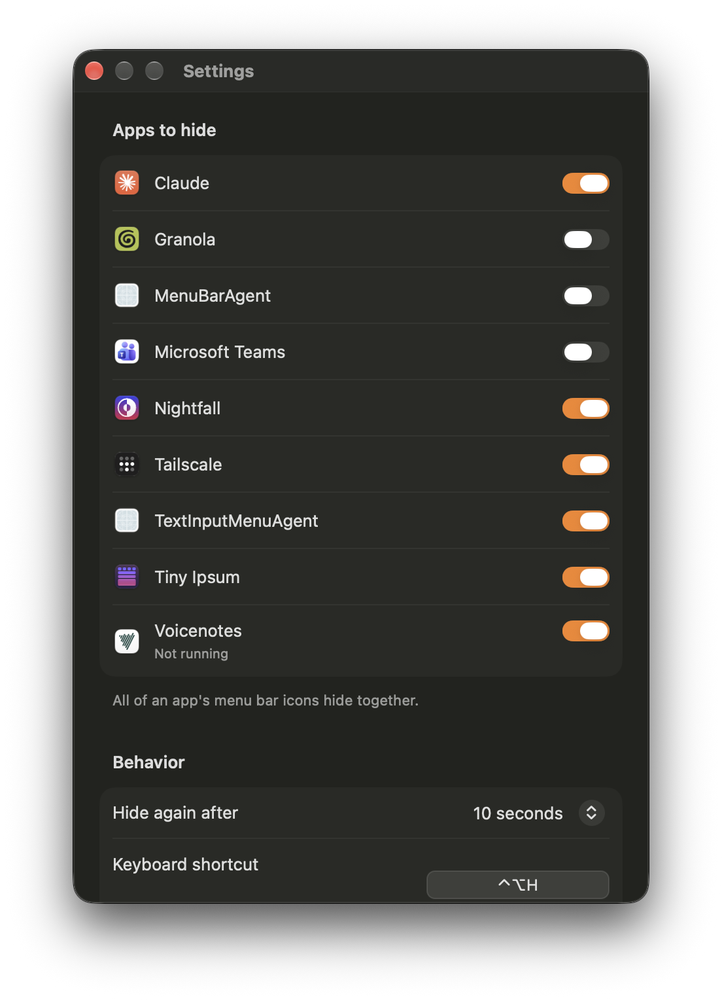

# Stow

A personal macOS 27 menu bar utility that hides the menu bar icons of apps you choose behind one drawer icon. It replaces Hidden Bar, whose App Store build stopped hiding anything on macOS 27.

<br>


- Design: `docs/superpowers/specs/2026-10-12-stow-design.md`
- Why it works this way: `docs/macos-27-menu-bar-findings.md`
- On-device results: `docs/verification.md`

## Install a release

Download `Stow-<version>.zip` from the repo's Releases. Unzip it, drag Stow to your Applications folder, and open it. Stow needs macOS 27, and it must run from Applications.

## Build and install from source

```bash
scripts/install.sh
```

This builds Stow, signs it with your Apple Development identity, installs it to `/Applications/Stow.app` and relaunches it. Stow must run from `/Applications`, because exam mode doesn't recognize any other copy.

## Release

`scripts/release.sh` builds a signed, notarized zip that anyone can install. See `docs/releasing.md` for the one-time setup.

## Test

```bash
swift test
```

## Use

- Click the drawer to hide or show the apps you chose. Right-click or Control-click it for the menu.
- In Settings you can pick the apps to hide, the re-hide delay, the keyboard shortcut (Control-Option-H by default) and open at login.

  
- Grant Accessibility when asked. Stow only uses it to list which apps have menu bar icons, and never needs Screen Recording.

## Known limits

- Hiding is per app, so all of an app's icons hide together.
- While icons are hidden, macOS's exam mode is on. Clicking the clock won't open Notification Center, and Focus, Now Playing and the microphone and camera indicators may be hidden too (the small orange privacy dot stays).
- Icons from tools without a bundle ID hide whenever Stow hides.
- Stow relies on a private macOS framework (MenuBarClientCore). If a macOS update breaks it, Stow shows "unavailable" and leaves every icon visible.

## Regenerate the placeholder app icon

```bash
swift run MakeIcon Resources/AppIcon.icns
```
